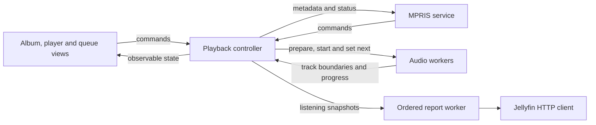

# Architecture

Jellyui is one Rust crate. `main.rs` hands control to `app::run`, which configures logging, GPUI, key bindings and the window. The window's root is `ui::shell::Jellyui`.

## Module boundaries

| Module | Owns |
| --- | --- |
| `domain` | Library metadata, artist credits, album queries, search ranking, sparse metadata pages, queue identities and ordering, playback states |
| `application` | Authentication, album and library request lifecycles, playback commands, prefetch decisions, listening reports and mapping playback state to desktop controls |
| `audio` | Decoder workers, bounded PCM buffering, continuous track handoff, source-format changes, PipeWire streams and shared volume |
| `infrastructure` | Jellyfin HTTP endpoints, progressive audio files, the cover disk cache, settings persistence and the MPRIS D-Bus service |
| `ui` | GPUI rendering, focus, gestures, menus, scrolling, artwork residency and animation |
| `app` | Process startup and window configuration |

`domain` imports neither GPUI nor any of the other application modules. It uses Serde for the metadata shared with Jellyfin. Queue ordering and search ranking can be tested without a window, server or audio device.

Application controllers use GPUI entities and tasks for observation, cancellation and delivery back to the main thread. They have no render implementations and do not import `ui`. They call concrete service APIs and share metadata models with Jellyfin.

Views observe controllers, read their state and issue commands. The playback queue is mutable only inside its controller. The player and queue sidebar cannot reach an audio handle, alter the queue directly or send listening reports. Navigation and context-menu requests are UI events handled by the shell.

Infrastructure does not import application controllers or UI modules. Jellyfin's report payloads and endpoint paths live in `infrastructure::jellyfin::reporting`; scheduling and ordering those reports belong to `application::reporting`.

The audio engine consumes the progressive `AudioFile` abstraction. Its decoder has no HTTP or Jellyfin request logic. `audio::device` contains PipeWire integration, while `audio::output` handles PCM consumption and track boundaries. Tests exercise output with synthetic buffers without opening an audio device.

## Ownership and lifetime

The shell creates one playback controller for the window. Browsing and signing in have their own controllers, so changing pages does not replace playback. An album page owns its album controller; leaving the page drops its request tasks. Album and library responses carry revisions so an older request cannot overwrite a newer selection or query. Replacing or releasing a library controller cancels its search.

The three library views keep their own query, scroll position and metadata controller. A view supplies visible item ranges to its controller. The controller fetches visible and adjacent pages, retains bounded metadata, and exposes the server's total count. Grid columns and scroll geometry stay in the view.

Encoded visible covers and decode/GPU residency belong to the artwork UI. Grid images opt into display-sized rasters in `ui::components::artwork`, which downsamples decoded pixels before texture upload and releases the full-size decoded buffer. Raster targets use layout bounds and display scale. Size changes debounce for 100 ms while the previous raster remains visible, and generation checks reject stale work. The persistent cover cache belongs to infrastructure and retains the original PNG. The player owns its resized thumbnail and releases it when the controller's cover changes, including when sign-in replaces the player on screen.

Playback owns queue requests, replacement confirmation state, the current audio handle and next-track preparation. The shell connects it to the authenticated session; playback commands carry metadata rather than HTTP clients. The player owns seek previews and volume gestures. The sidebar owns drag payloads, scroll state and queue animation. A transport revision lets the player cancel a seek preview when output restarts, including a desktop seek within the same queue entry.

## Playback flow

Audio workers select prepared next tracks independently of GPUI polling. The controller follows stable queue-entry IDs in boundary events, updates metadata, reports listening and prepares the next entry. Reordering and removal go through controller methods that also update preparation and reporting. The UI never drives automatic handoff.

## Where to make changes

- Add a player control in `ui/player`; put its playback decision in `application/playback/transport.rs`.
- Change queue appearance or drag feedback in `ui/queue`; change ordering rules in `domain/queue.rs`.
- Change filtering widgets in `ui/library/filters.rs`, page scheduling in `application/library.rs`, or search ranking in `domain/search.rs`.
- Change album layout in `ui/album`; change request and retry behavior in `application/album.rs`.
- Add a Jellyfin endpoint beside the relevant methods in `infrastructure/jellyfin`.
- Change decode or output policy in `audio/decoder.rs`, `audio/output.rs` or `audio/device.rs`.
- Change colors through the named Catppuccin constants in `ui/theme.rs`.

Tests live beside their owner or in that module's `tests.rs`. HTTP tests use local servers, MPRIS tests use a private bus, and audio tests use local fixtures. Run the checks listed in the README after changing controller boundaries or worker lifetimes.
